<h1 align="center">Lutefisk Book Editor</h1>

<p align="center"><b>A desktop app for writing, designing and publishing books.</b><br>
macOS · Windows · Linux · Free and open source</p>

> [!WARNING]
> **Experimental and unsupported.** Lutefisk Book Editor is provided as is, with no support, no warranty and no promise of updates. Features may change, and books made with one version might not open in another. Keep your own backups. See the [Disclaimer](#disclaimer).

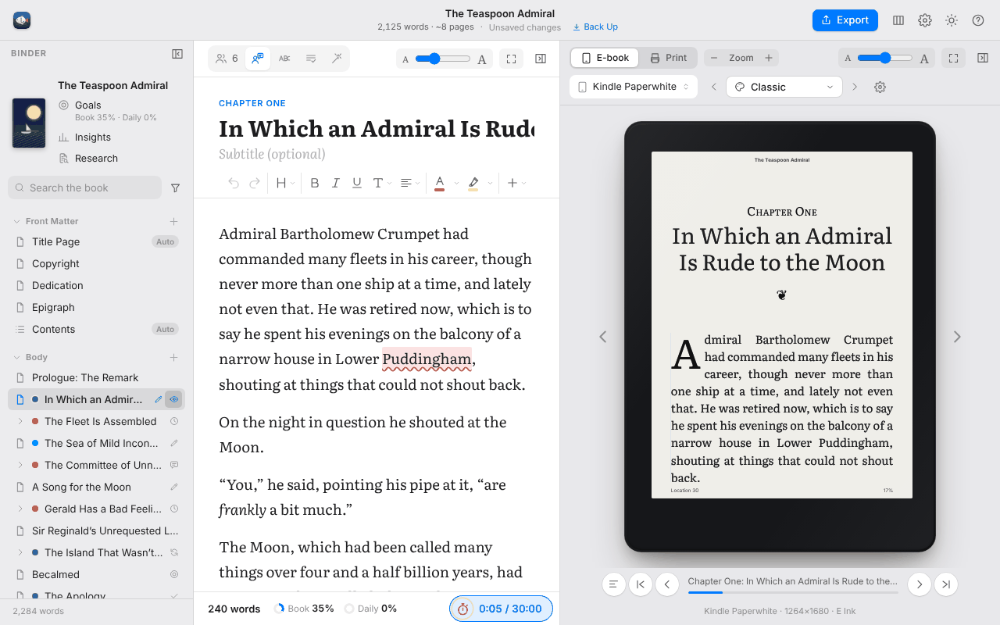

Lutefisk Book Editor puts your manuscript and the finished book side by side. You write in the middle, organize chapters and scenes on the left, and see each page on the right as it will look on an e-reader, a tablet or in print. Everything stays on your computer.

## Features

| | |
|---|---|
| **Write** | Paragraph styles, text color, highlighting, lists, tables, pictures, drawings, LaTeX formulas, code, footnotes, citations and margin comments |
| **Organize** | Chapters and scenes, front and back matter, labels, statuses, search and replace, and a Recycle Bin |
| **Check** | Spelling, grammar and style checked as you type, on your computer |
| **Preview** | Kindle, Kobo, Nook, iPhone, iPad and Android devices drawn to scale, and the printed book as an open spread |
| **Design** | About 95 templates, drop caps, ornaments, trim sizes, papers and a watermark |
| **Plan** | Research notes, files and index cards, a bibliography, characters, a plot board and a timeline |
| **Track** | Daily and book goals, a writing history and Insights on your text |
| **Export** | EPUB 3, PDF, Word (.docx), RTF, MOBI, Markdown and plain text |

## A tour

### Write

The toolbar has paragraph styles (headings, block quote, verse, hanging indent, attribution), bold, italic and underline, text color, a highlighter and alignment. The **+** menu inserts links, pictures, lists, tables, code, formulas, symbols, drawings, citations, footnotes, line breaks and scene breaks. Right-click the toolbar to move it below the text.

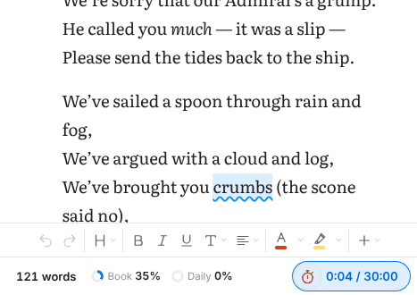

Right-click in the text for comments, index cards, characters and the same **Insert** items. Right-click a title for **Capitalize My Title**.

<p align="center">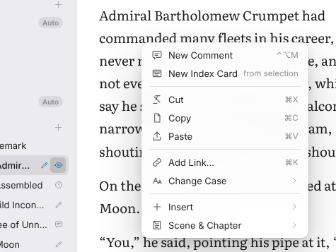</p>

### Check spelling and grammar

Problems are highlighted as you type: spelling in red, grammar in blue and style in purple. Right-click a highlighted word for suggestions, **Add to Dictionary** or **Ignore**. The **Spelling** and **Grammar** buttons above the text turn checking on and off.

<p align="center">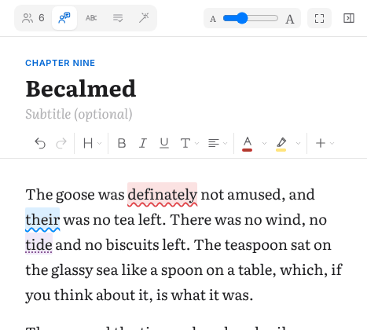</p>

### Insert code

Code blocks come in dozens of languages, with syntax colors and optional line numbers. Right-click a block to change its colors, border, alignment and padding.

<p align="center">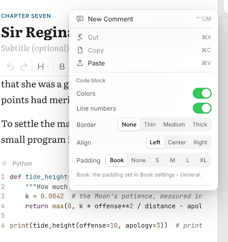</p>

### Preview on real devices

Click the device name, then point at a device or use ↑ and ↓ to see the book change as you go. Press Return to keep it, or Esc to go back.

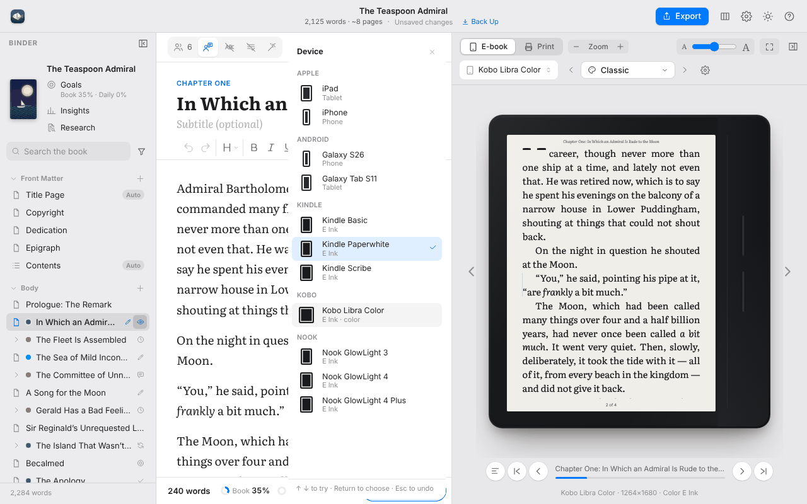

Every device is drawn to scale from its published dimensions.

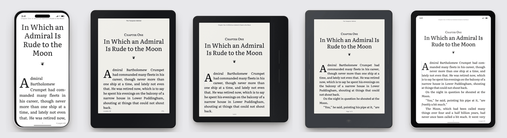

### Choose a template

Click the template name beside the device. Point at a design to see it on the device, and click or press Return to choose it. Each template sets the fonts, headings, drop cap, ornaments and scene breaks for both the e-book and the print edition. Use the ⚙ button to edit a template or make your own.

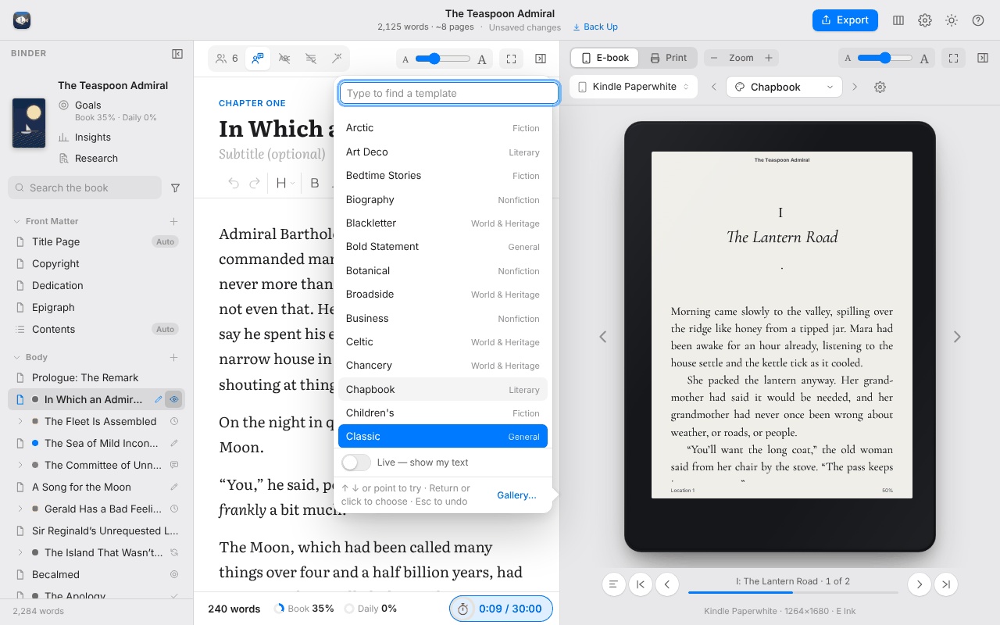

### Print

**Print** shows the book as an open spread, exactly as the PDF will look. Choose a trim size, the type size and a paper color, or a faint artwork page inspired by traditional patterns from around the world. **Book settings › Print** adds a watermark such as DRAFT.

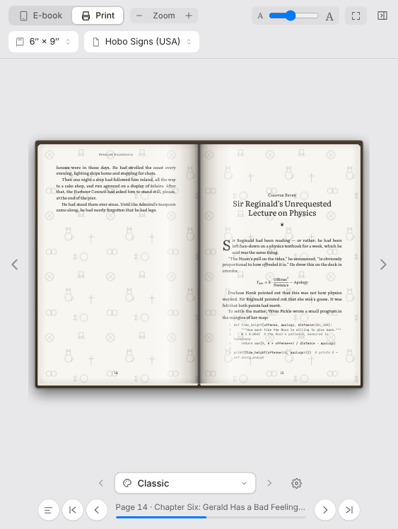

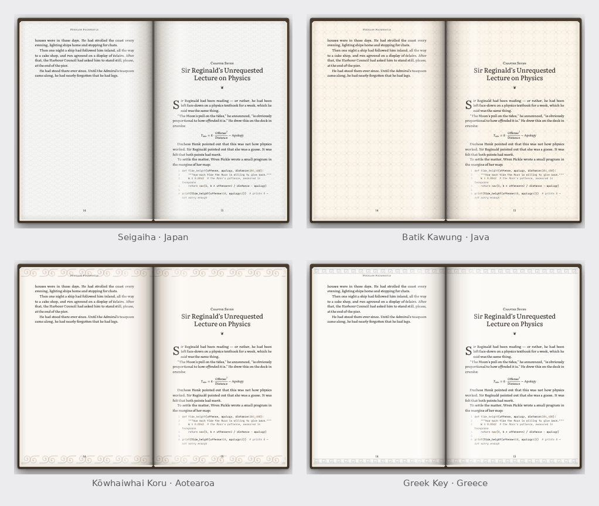

### Research

**Research** is the book's notebook: Markdown notes with a live preview, uploaded pictures and documents, and index cards. To turn a passage into an index card, select it and right-click › **New Index Card**. Characters, the plot board, the timeline and the bibliography open from here too. Nothing in Research is printed.

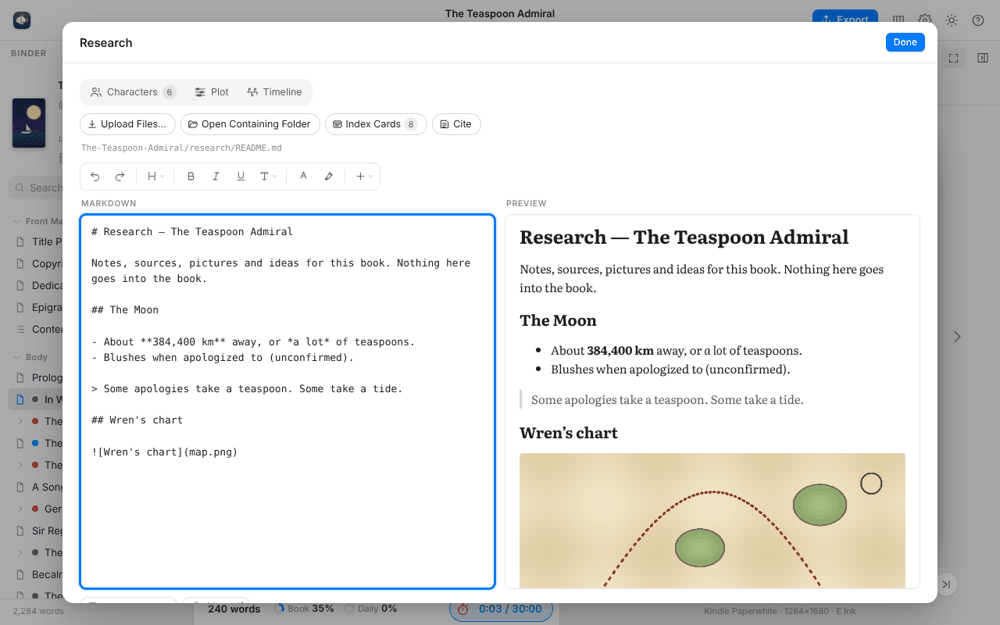

### Cite your sources

In the **Bibliography**, choose **Add New Source**, paste a link or DOI and press **Analyze** to fill in the title, authors and date. Sources are formatted in APA, MLA, Chicago or IEEE; choosing a style shows its rules and examples before you apply it. Insert a citation with right-click › **Insert › Citation…**.

### Plan the story

Keep a cast of characters with portraits, and see the chapters each one appears in. Lay out plotlines on a board, then see the events in story order on a timeline that marks flashbacks.

<p>
  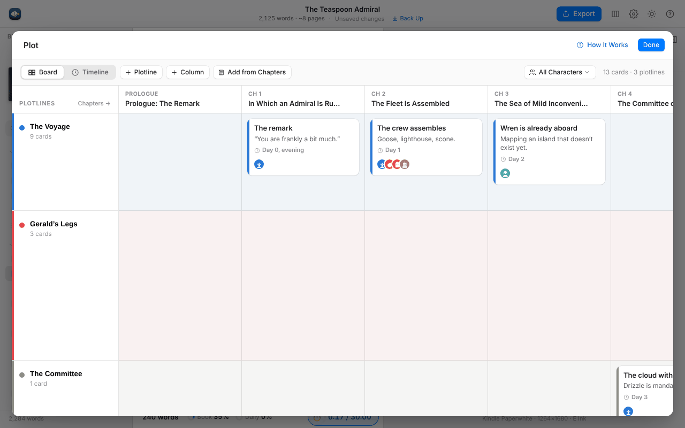
  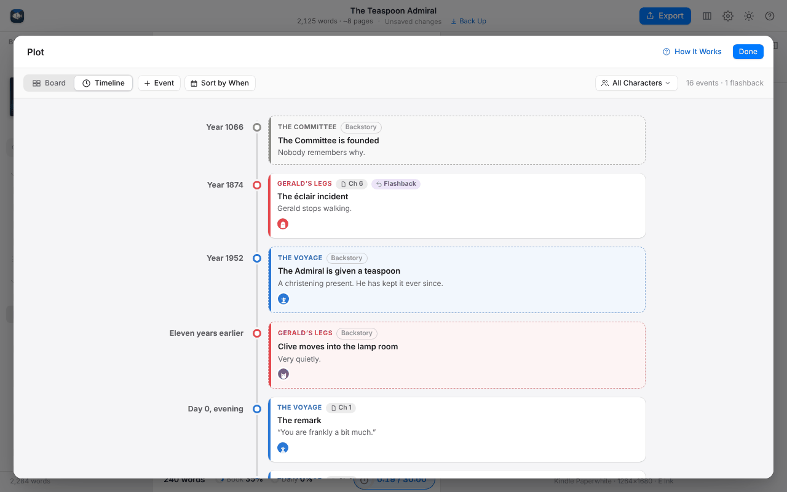
</p>

### Set goals

Set a goal for the whole book and one for each day, in words, pages or hours. A countdown shows the time left before your deadline.

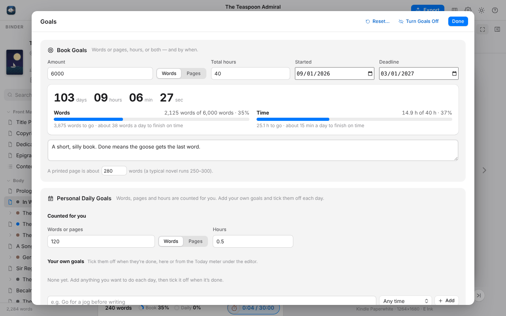

Charts show your words per day, the book's size and your writing time.

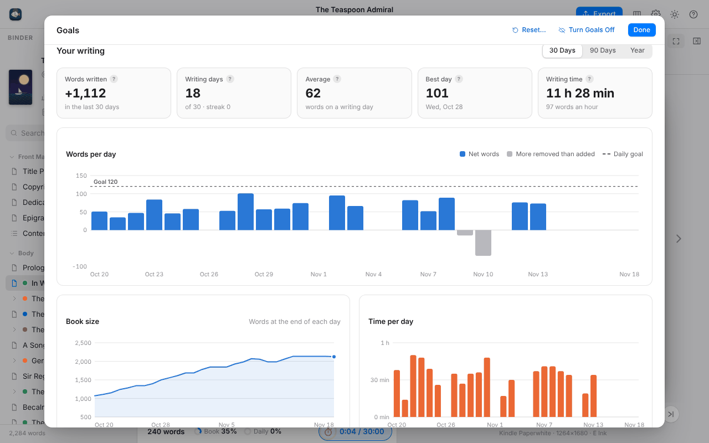

### Insights

Word counts, reading time, readability, sentence length, active and passive voice, adverbs, repeated phrases and possible spelling and grammar problems, for the whole book or a single chapter.

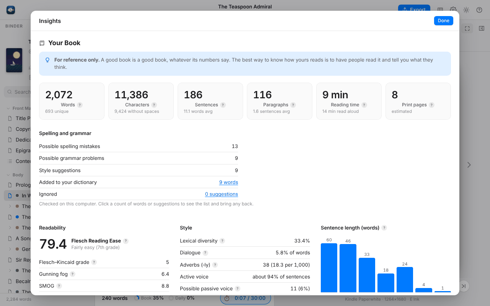

### More

- **Day and night** themes and 14 skins.
- **Vision and comfort:** larger interface text, an easier-to-read font, stronger contrast and reduced motion.
- **16 interface languages.**
- **Focus mode** for the editor and the preview.
- **Back Up** a book as a .zip (⇧⌘S).
- **Help and a guided tour:** press F1.

## Getting started

Lutefisk Book Editor runs from its source code. Setup takes about 15 minutes, once.

1. **Install Node.js 22 or later.** Download the **LTS** installer from [nodejs.org](https://nodejs.org) and run it with the standard choices. On Linux, follow the instructions for your system at [nodejs.org/en/download](https://nodejs.org/en/download).
2. **Download Lutefisk Book Editor.** On this page, click **Code › Download ZIP**, then unzip it.
3. **Open a terminal in the lutefisk-book-editor folder** (after unzipping, it may be called lutefisk-book-editor-main).
   - **Windows:** open the folder, click the address bar, type `cmd` and press Enter.
   - **Mac:** open Terminal, type `cd ` (with a space after it), drag the folder onto the window and press Return.
   - **Linux:** right-click inside the folder and choose **Open in Terminal**.
4. **Install** (once; it takes a few minutes):
   ```
   npm ci
   ```
5. **Start Lutefisk Book Editor:**
   ```
   npm start
   ```

From then on, open a terminal in the folder and type `npm start`.

**Troubleshooting**

- *"npm is not recognized"*: open a new terminal, or restart the computer after installing Node.js.
- *"Running scripts is disabled"* on Windows: use Command Prompt (`cmd`), not PowerShell.
- *"The SUID sandbox helper binary was found, but is not configured correctly"* on Linux: in the lutefisk-book-editor folder, run<br>
  `sudo chown root node_modules/electron/dist/chrome-sandbox && sudo chmod 4755 node_modules/electron/dist/chrome-sandbox`

**Updating:** your books are in the `local` folder inside lutefisk-book-editor, unless you chose another folder in Settings. Copy `local` into the new version's folder, then run `npm ci` and `npm start` there.

**Building a stand-alone app:** run `npm run package:win`, `npm run package:mac` or `npm run package:linux` on that system. The app appears in `release/` and runs without Node.js.

**With Git:** `git clone https://github.com/johnlwhiteman/lutefisk-book-editor.git`, then `npm ci` and `npm start` in that folder. Update with `git pull` and `npm ci`.

**Trying it out:** `node scripts/make-test-novel.mjs` writes *The Teaspoon Admiral*, a short test novel that uses nearly every feature, into `local/books`.

## Your books

Each book is an ordinary folder:

```
My Book/
├── lutefisk.yaml   title, authors, settings, characters, plot, goals
├── chapters/       one Markdown file per chapter
├── research/       notes, index cards and files (never printed)
└── assets/         cover, pictures and portraits
```

When you run Lutefisk Book Editor from its source folder, books go in `local/books`, which Git ignores. A packaged app keeps them in `Documents/Lutefisk`. You can change the folder in Settings.

## Privacy

- **Your writing stays on your computer.** There are no accounts, cloud sync, telemetry, crash reports or automatic updates.
- **Spelling and grammar on your computer.** Checking runs on your computer; nothing is sent anywhere.
- **Offline.** The app makes no network requests on its own. The one exception is **Analyze** in the bibliography: when you press it, it fetches the link you pasted to fill in the source's details. It sends nothing from your book.
- **Locked down.** The interface is sandboxed with a strict Content Security Policy, every file path is checked, and raw HTML in Markdown is disabled. `npm test` includes a privacy test that fails if anything else could reach the network.

See [SECURITY.md](SECURITY.md) for the full security model and how to report a problem, and [CHANGELOG.md](CHANGELOG.md) for what's changed.

## Project layout

```
src/main/       windows, files, exports, PDF printing
src/preload/    the bridge to the interface
src/renderer/   the interface: binder, editor, previews, panels, help
src/shared/     Markdown, templates, citations, book → HTML
scripts/        build, package, SBOM, locales, test novel
test/           unit and end-to-end tests
```

`npm audit` reports no known vulnerabilities, and `npm run sbom` writes a software bill of materials to `sbom/`.

## License

[MIT](LICENSE)

## Disclaimer

Lutefisk Book Editor is an experimental, unsupported project.

- **No support.** Questions, bug reports and feature requests may go unanswered.
- **No warranty.** The software is provided "as is", without warranty of any kind.
- **Things may change.** Features and the book format can change between versions without a migration path.
- **Back up your work.** Lutefisk Book Editor includes a Back Up command, but it's no substitute for your own backups.
- **Check before you publish.** Always check exported files in the store's or printer's own tools.
- **Use at your own risk.** The authors are not liable for lost work, damaged files or any other problem arising from its use.
